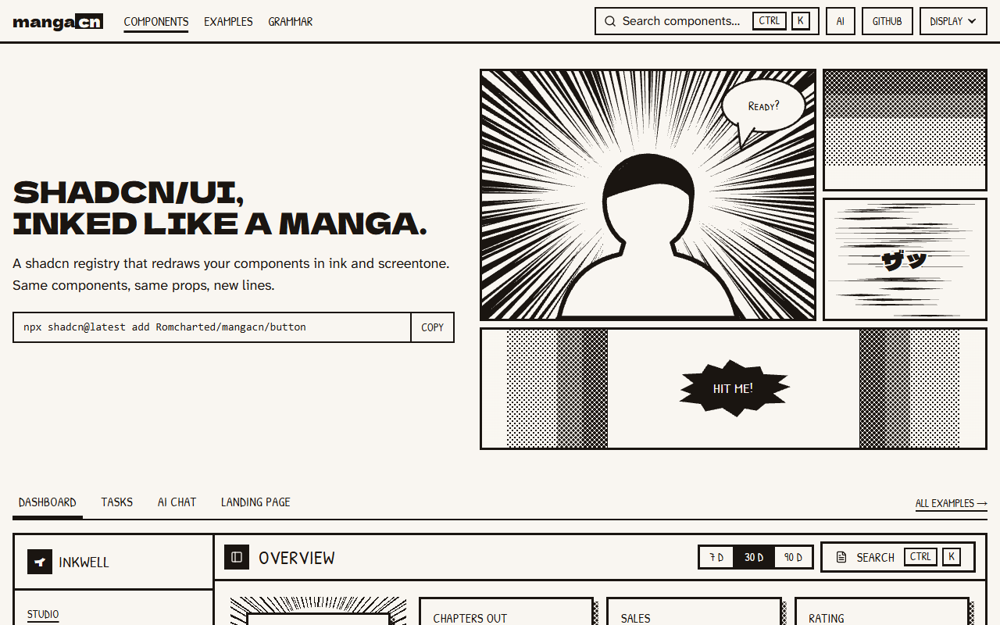
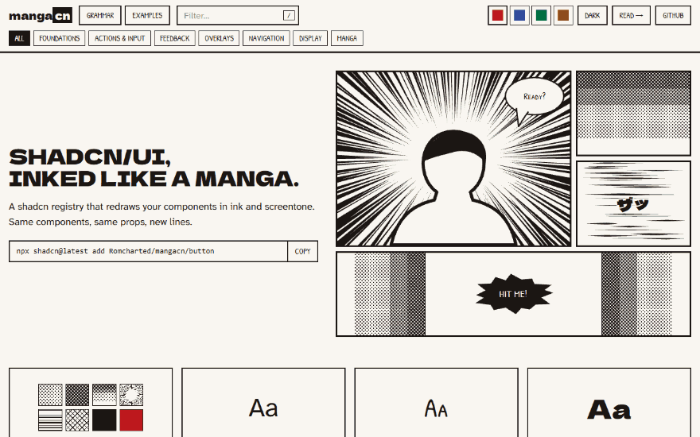

# mangacn

**shadcn/ui, inked like a manga.** An open source [shadcn registry](https://ui.shadcn.com/docs/registry) that
redraws your shadcn/ui components in ink and screentone: black and white, sharp lines, tones instead of grey,
speed lines, and one accent colour you choose.

[Showcase](https://DOMAIN/) ·
[Grammar](https://DOMAIN/#grammar) ·
[Examples](https://DOMAIN/#examples) ·
[llms.txt](https://DOMAIN/llms.txt)

> `DOMAIN` stands for the showcase address, set when the site goes live.

[](https://DOMAIN/)

It does not fork shadcn. Each restyled component is a thin file that imports **your** shadcn component, adds
classes and `data-*` attributes, and re-exports it with the same props. It works whether your shadcn project
is built on Radix or on Base UI.



## Install

In a project already set up with shadcn (`npx shadcn@latest init`), one command:

```bash
npx shadcn@latest add Romcharted/mangacn/button
```

That installs the manga Button and everything it needs: `base` (tokens, screentone utilities, stepped
animations), `gestures` (impact and flash primitives) and three fonts under the SIL Open Font License:
Atkinson Hyperlegible Next (reading), Patrick Hand SC (lettering) and Dela Gothic One (sound effects, katakana
included). Add several items at once by listing them:

```bash
npx shadcn@latest add Romcharted/mangacn/dialog Romcharted/mangacn/tabs Romcharted/mangacn/speech-bubble
```

Where files go:

- restyled shadcn components: `components/ui/manga/<name>.tsx` (your `ui` alias + `/manga`); each one wraps
  your own `components/ui/<name>`, which the CLI adds if it is missing;
- manga pieces (speech bubble, screentone, speed lines, panels…): `components/manga/<name>.tsx`;
- the gestures: `lib/manga/gestures.tsx`.

Then import from the manga folder:

```tsx
import { Button } from "@/components/ui/manga/button"

export function Cta() {
  return <Button variant="shout">Read chapter 1</Button>
}
```

Browse the catalogue from the CLI:

```bash
npx shadcn@latest list Romcharted/mangacn
npx shadcn@latest search Romcharted/mangacn --query bubble
```

## Components

<!-- items:start -->

128 items. Each one installs with `npx shadcn@latest add Romcharted/mangacn/<name>`.

### Foundations

| Name | Item | What it looks like |
| --- | --- | --- |
| Manga base | `base` | Ink, paper and one accent colour, screentone, speed lines, stepped motion. |
| Font: Atkinson Hyperlegible Next | `font-body` | The reading face for text and fields. |
| Font: Patrick Hand SC | `font-lettering` | Hand lettering for titles, buttons and badges. |
| Font: Dela Gothic One | `font-sfx` | A heavy face for sound effects, katakana included. |
| Font: Zen Kaku Gothic New | `font-japanese` | A Japanese reading face for furigana and vertical text. |
| Gestures | `gestures` | Impact and flash primitives shared by every component. |
| Typography | `typography` | Headings in lettering, body in the reading face, narration in a case. |
| Direction | `direction` | Left to right or right to left, for the whole subtree. |

### Actions & input

| Name | Item | What it looks like |
| --- | --- | --- |
| Button | `button` | Ink flats, a tone band, a burst for the one call to action. |
| Input | `input` | A 2px ink line that thickens on focus; serrated with a “!” on error. |
| Select | `select` | An ink-lined trigger; the list pops in as a notched case. |
| Checkbox | `checkbox` | A square box; the brush check draws itself. |
| Switch | `switch` | Paper track and ink thumb when off, the negative when on. |
| Textarea | `textarea` | Input's ink line, for longer text. |
| Label | `label` | Lettering for field labels. |
| Field | `field` | Labels, help text and errors with a “!” mark. |
| Radio Group | `radio-group` | Diamonds instead of circles; the chosen one turns to ink. |
| Slider | `slider` | A rail that fills with speed lines. |
| Command | `command` | A notched case of commands: the highlighted row inverts to ink. |
| Toggle | `toggle` | An ink-lined switch that floods with ink when on. |
| Toggle Group | `toggle-group` | Toggles joined in one frame; the pressed cell floods with ink. |
| Button Group | `button-group` | Buttons joined by one shared 2px line, like a strip of cells. |
| Input Group | `input-group` | One ink line around a field and its addons, with a small lettered button inside. |
| Native Select | `native-select` | A real select, drawn in ink with a brush chevron. |
| Combobox | `combobox` | Type to find; the list pops in as a notched case and marks your pick with a brush check. |
| Input OTP | `input-otp` | Code boxes joined in one ink frame, with a stepped caret. |
| Calendar | `calendar` | A month drawn in ink: chosen days turn to flat ink, today gets a frame. |
| Date Picker | `date-picker` | An ink field that opens a calendar in a speech bubble. |
| Questionnaire | `questionnaire` | One question at a time, in an inked case with a running progress rail. |

### Feedback

| Name | Item | What it looks like |
| --- | --- | --- |
| Badge | `badge` | Ink, outline, burst and a tilted stamp. |
| Skeleton | `skeleton` | A light screentone that flickers while content loads. |
| Toast (Sonner) | `sonner` | Toasts in a 3px panel, with room for a sound effect. |
| Alert | `alert` | A case that pops in; errors shake with a “!”. |
| Progress | `progress` | A rail that fills with speed lines, in steps. |
| Spinner | `spinner` | Concentration lines turning in steps. |
| Empty | `empty` | An empty panel with a heavy “…”. |
| Trace | `trace` | An agent's steps, inked line by line with status marks. |

### Overlays

| Name | Item | What it looks like |
| --- | --- | --- |
| Dialog | `dialog` | A centred panel over a light screentone veil. |
| Tooltip | `tooltip` | A tiny speech or thought bubble. |
| Alert Dialog | `alert-dialog` | A case that pops in over a screentone veil. |
| Popover | `popover` | A speech bubble pointing at its trigger. |
| Hover Card | `hover-card` | A preview in a speech bubble. |
| Dropdown Menu | `dropdown-menu` | A notched case; the row under the pointer turns to ink. |
| Sheet | `sheet` | A case sliding in from the edge. |
| Context Menu | `context-menu` | A case that opens at the pointer; the row under it turns to ink. |
| Drawer | `drawer` | A case that slides up from the edge, with an ink grab bar. |

### Navigation

| Name | Item | What it looks like |
| --- | --- | --- |
| Tabs | `tabs` | Chapter dividers, a thick underline or boxed tabs. |
| Pagination | `pagination` | Cells for pages; the current one is ink. |
| Breadcrumb | `breadcrumb` | Lettering, brush chevrons, the current page in ink. |
| Navigation Menu | `navigation-menu` | Lettering triggers; the open one turns to ink and its panel is a case. |
| Sidebar | `sidebar` | A ruled side panel: ink rows, an ink flat for the current one, a sheet on mobile. |
| Menubar | `menubar` | A lettering bar of menus; the open one turns to ink. |

### Display

| Name | Item | What it looks like |
| --- | --- | --- |
| Card | `card` | A comic panel with a screentone shadow. |
| Table | `table` | An ink header, 1px rules, and an ink bar for the hovered row. |
| Accordion | `accordion` | Stacked cases; the open one turns to ink. |
| Avatar | `avatar` | A square panel for a face or initials. |
| Separator | `separator` | An ink rule: 2px, fine or double. |
| Bubble | `bubble` | Chat messages as speech bubbles. |
| Message | `message` | A line of a conversation: avatar, name, bubbles. |
| Scroll Area | `scroll-area` | Ink thumb in a fine track, square corners, no fade. |
| Collapsible | `collapsible` | A lettering row that unfolds, its chevron turned to ink. |
| Item | `item` | A list row or a case, with a square media and lettering titles. |
| Kbd | `kbd` | A key cap in ink, with a heavier bottom edge like a pressed key. |
| Chart | `chart` | Recharts in screentone: each series gets its own pattern, never a colour. |
| Data Table | `data-table` | Sort, filter, select and page a list in an ink-lined table. |
| Resizable | `resizable` | Panels divided by a 2px ink line with a grip to pull. |
| Aspect Ratio | `aspect-ratio` | A box of a fixed ratio for covers, panels and frames. |
| Carousel | `carousel` | Panels in a strip, turned with brush arrows. |
| Attachment | `attachment` | A file attached to a message, with its progress and errors. |
| Marker | `marker` | A line in the conversation: a date, a switch, a compaction. |
| Message Scroller | `message-scroller` | A conversation column that jumps back to the latest line. |
| Code Block | `code-block` | A code frame in ink, with a copy square that stamps a check. |

### Manga pieces

| Name | Item | What it looks like |
| --- | --- | --- |
| Speech Bubble | `speech-bubble` | Seven bubble shapes drawn at their real size. |
| Screentone | `screentone` | Any tone: dots, lines, cross-hatching or noise, with a stepped fade. |
| Speed Lines | `speed-lines` | Focus or motion lines to make a moment hit. |
| Panel | `panel` | A manga page: tiers, slanted cuts, templates, bubbles that aim. |
| Sfx | `sfx` | Sound effects in heavy lettering, with a paper knockout. |
| Manpu | `manpu` | Emotion marks: anger, sweat, surprise… |
| Burst | `burst` | A starburst for news and shouts. |
| Stamp | `stamp` | A seal that lands with a thump. |
| Banner | `banner` | A ribbon for titles and announcements. |
| Stepper | `stepper` | Chapter marks for a multi-step flow. |
| Stat | `stat` | A key figure in heavy lettering. |
| Toned Image | `toned-image` | A photo turned into a screentone, in your browser. |
| Character Card | `character-card` | A character sheet: portrait, stats in bars, a quote. |
| Impact Counter | `impact-counter` | A score that jumps on every hit. |
| Versus Panel | `versus-panel` | Two options split by a diagonal, with a VS burst at the crossing. |
| Loading Screen | `loading-screen` | A waiting screen of concentration lines and a sound effect. |
| Volume Card | `volume-card` | A manga volume with its cover, status and reading progress. |
| Typing Bubble | `typing-bubble` | A bubble that waits, then writes. |
| Reaction Picker | `reaction-picker` | React with manga emotion marks. |
| Reader Strip | `reader-strip` | Pages in a vertical strip, for scroll reading. |
| Reading Progress | `reading-progress` | How far the reader has gone, in speed lines. |
| Page Reader | `page-reader` | A manga read page by page: spreads, reading order, swipe, zoom and full screen. |
| Page Thumbnails | `page-thumbnails` | Every page of a chapter in a grid, to jump anywhere. |
| Guided View | `guided-view` | A manga read panel by panel: the screen zooms from one panel to the next. |
| Reader Settings | `reader-settings` | Reading order, mode, fit and background for a manga reader. |
| Chapter End | `chapter-end` | The end card of a chapter: to be continued, and the next chapter. |
| Shelf | `shelf` | Volumes on a shelf, spine out: pull one to open it. |
| Series Header | `series-header` | Cover, title, status, genres, a folding summary and the actions of a series. |
| Obi Band | `obi-band` | A promotional band wrapped round the lower part of a volume. |
| Spoiler | `spoiler` | Hidden under a screentone until the reader taps. |
| Ranking List | `ranking-list` | A weekly ranking with big numbers, covers and change marks. |
| Release Calendar | `release-calendar` | A week of releases: a day strip on phones, seven columns on wide screens. |
| Social Button | `social-button` | A sign-in button with a logo plate and an “or” rule. |
| Password Strength | `password-strength` | A four-step gauge that fills with speed lines. |
| Yonkoma | `yonkoma` | Four panels, top to bottom, to tell it in four beats. |
| Dialogue Box | `dialogue-box` | A character speaks, line after line, with an arrow to go on. |
| Chapter Title | `chapter-title` | A chapter page that opens a section. |
| Magazine Cover | `magazine-cover` | A magazine cover: masthead, issue, cover lines around the art. |
| Scene Transition | `scene-transition` | A stepped wipe between two scenes. |
| Ruby | `ruby` | Furigana over the characters they read. |
| Vertical Text | `vertical-text` | Text written top to bottom, columns right to left. |
| Bilingual Bubble | `bilingual-bubble` | A speech bubble that flips between the original and its translation. |

### Full interfaces

| Name | Item | What it looks like |
| --- | --- | --- |
| Dashboard | `dashboard` | Sidebar, key figures, toned charts, a data table and a command palette. |
| Tasks | `tasks` | A task board: stamps for statuses, filters and actions on a selection. |
| Landing page | `landing-page` | An opening page, features in panels, pricing as a versus, reviews in bubbles. |
| AI chat | `ai-chat` | Thinking in a thought bubble, errors shouted, answers typed as they come. |
| Manga Reader | `manga-reader` | A vertical strip, chapters in a sheet, progress and reading order. |
| Author Site | `author-site` | A manga author's site: catalog, series page, then the chapter read page by page or panel by panel. |
| Developer portfolio | `portfolio` | Intro panels, projects on a manga page, skills as a character sheet, a contact form. |
| Catalog | `catalog` | Volume cards, filters, tabs and search. |
| Sign in | `sign-in` | A manga panel beside the sign-in form, with social buttons and a jagged error box. |
| Verify code | `verify-code` | Six digits, a resend countdown and a stamp when the code is right. |
| Reset password | `reset-password` | A new password with a strength gauge, then a 'Saved!' stamp. |
| Sign up | `sign-up` | A manga panel beside the sign-up form, with a strength gauge and social buttons. |
| Forgot password | `forgot-password` | A manga panel beside a one-field recovery form that stamps “Sent!”. |
| Story landing | `story-landing` | A product page told as a manga: cover, four-panel strip, a guide, chapters. |

<!-- items:end -->

## The grammar

Every component draws its motion from the same eight gestures, written once in `base`: case (G1), flat (G2),
hover (G3), impact (G4), pop (G5), bubble (G6), running line (G7) and mark (G8). They move in steps at
12 frames per second and stand still under `prefers-reduced-motion`. The
[Grammar page](https://DOMAIN/#grammar) shows each one; [AGENTS.md](AGENTS.md) has the
rules.

## Dark mode, accent colour, reading order

- Dark mode uses shadcn's `.dark` class: the negative of the page.
- One accent colour, `--mg-accent` (stamp red by default). Presets: `data-accent="indigo"`, `"pine"`, `"ochre"`.
- Manga reading order: `data-reading="rtl"` on `<html>` and the `reading-rtl:` variant flip panels and
  bubbles right to left; text stays left to right. Writing direction (`dir="rtl"`) is supported separately.

## Use with AI assistants

- **llms.txt** lists every item with its install command, main props and a minimal example:
  `https://DOMAIN/llms.txt`.
- **shadcn MCP server.** The MCP server reads the registries declared in `components.json`. Add a namespace
  that points at the JSON files this repo publishes:

  ```json
  {
    "registries": {
      "@mangacn": "https://DOMAIN/r/{name}.json"
    }
  }
  ```

  Then set up the server for your assistant and restart it:

  ```bash
  npx shadcn@latest mcp init --client claude   # or cursor, vscode, codex, opencode
  ```

  Try: “Show me the components in the mangacn registry”, “Add the mangacn dialog and tabs”. With the
  namespace set, `npx shadcn@latest add @mangacn/<item>` works too.

## Develop

```bash
npm install
npm run dev        # showcase
npm run build      # sync base CSS, llms.txt and this README's list; typecheck; build the site and r/*.json
npm run shots      # screenshots of the built site (light and dark)
npm run check      # every item complete: files, meta, llms.txt, README, built JSON, demo
```

See [AGENTS.md](AGENTS.md) for conventions, how to add a component, and the style rules.

## Known issues

- **Vite + Base UI: `tsc -b` fails on `src/components/ui/scroll-area.tsx`** with `'React' is declared but its value
  is never read`. The file is shadcn's own Scroll Area, not a mangacn file: the same error shows in a fresh project
  with only `npx shadcn@latest add scroll-area`, without mangacn. `vite build` alone passes. Workaround: delete the
  unused `import * as React from "react"` line at the top of that file, or turn off `noUnusedLocals` in
  `tsconfig.app.json`.
- **Next.js: a Yonkoma with `orientation="auto"` jumps at hydration.** The server cannot measure the strip, so it
  renders the four panels in a column; once the browser measures 40rem or more, they move into a row. The layout
  is computed in JavaScript, so a container query cannot stand in. Workaround: pass `orientation="vertical"` or
  `"horizontal"` when you know the space, or render the strip on the client only (`next/dynamic` with
  `ssr: false`).

## License

[MIT](LICENSE). Fonts are served by Google Fonts under the SIL Open Font License. The showcase's demo art is **AI-generated**: "Mapless", a series invented for this repo (two
covers, two pages, a portrait and crops of them, credits in [site/public/art/CREDITS.md](site/public/art/CREDITS.md)).
The registry items ship no image. Not affiliated with shadcn.
